<p align="center">
  <picture>
    <source media="(prefers-color-scheme: dark)" srcset="docs/logo/homedroid-logo-dark.svg">
    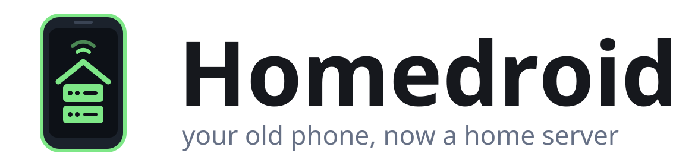
  </picture>
</p>

# Homedroid: turn an old Android phone into a home server

[](https://github.com/sudiptacmd/homedroid/releases)
[](https://github.com/sudiptacmd/homedroid/actions/workflows/build.yml)
[](LICENSE)


**[Website](https://homedroid.seltiv.com/) · [Download 0.9.5 beta](https://github.com/sudiptacmd/homedroid/releases/tag/v0.9.5-beta) · [Desktop companion](#homedroid-desktop) · [Send feedback](https://github.com/sudiptacmd/homedroid/issues/new/choose)**

That phone in your drawer still has a CPU, a camera, Wi-Fi and storage. It can do more than
hold a charge badly. **Homedroid turns an old Android phone into a self-hosted home server**:
Jellyfin, a NAS for USB drives and microSD cards, photo backup, web apps, local AI and home
automation. Install one APK, start the server, open the web dashboard. **No root or Termux.**

In **0.9.5 beta**, it also earns its place on the desk: a standby clock, a MacroPads button
deck and a wireless webcam through Homedroid Desktop. Free software, built by Sudipta Goswami.

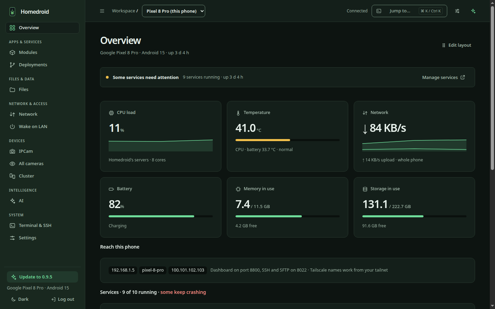

*Phone screenshots are from an emulator. Dashboard screenshots use the actual dashboard with
mock API data, not hardware benchmarks. Last updated: 25 November 2026.*

## What’s new in 0.9.5

- **A redesigned phone app:** Material 3, wallpaper colours on Android 12+, OLED black and
  burn-in protection. The app library and settings have been rebuilt too.
- **A dashboard you can arrange:** six layouts (sidebar, rail, top bar, split, focus and kiosk),
  13 themes, font choices, overview widgets and a Ctrl/Cmd+K command palette. Preferences live
  on the phone and follow you between browsers.
- **Dock mode:** five clock faces, live server tiles, a red night mode and OLED care. Works
  while charging or as Android’s screen saver. Four status widget sizes and a new clock widget.
- **MacroPads + Homedroid Desktop:** custom phone buttons for your computer, plus a wireless
  phone webcam. Linux, Windows and macOS companion downloads below.
- **Hosting from the dashboard:** add your own domain, keep dynamic DNS (DuckDNS or Cloudflare)
  updated, set firewall rules and read request logs. Go, PHP, Bun and Deno join Node.js, Python
  and static deployments. Upload ZIP/tar archives, trigger deploys from CI, run build pipelines
  and roll deployments across load-balanced cluster phones.
- **MCP and databases:** let AI assistants such as Claude, Cursor and VS Code manage the server
  over MCP, with write tools off until you allow them and an on-phone agent that asks before
  it changes anything. Browse SQLite databases with a schema diagram and a SQL console, or use
  the JSON document store.
- **Your own mail server:** install Stalwart from the app catalog and follow the guided setup
  in the dashboard. It lists the DNS records to copy, runs health checks and shows the settings
  for your mail apps. Many home internet providers block port 25, so you may need a relay.
- **Wi-Fi repeater:** the phone hosts a Wi-Fi Direct network and shares its connection through
  a built-in HTTP, SOCKS5 and PAC proxy. Join with a QR code. It is proxy-based, so apps that
  ignore proxy settings will not work.
- **Security and fixes:** PIN/biometric app lock, Keystore-encrypted secrets, DNS install fixes,
  configurable SSH port, a terminal that works with SSH off, and installed-app updates from
  the phone or dashboard.

Camera controls for the PC webcam and a customizable look for MacroPads (backgrounds, fonts
and icons) are being worked on and are not in this beta yet. See the
[0.9.5 release notes](docs/releases/v0.9.5-beta.md) for verification limits.

## Download

Homedroid is **0.9.5 beta**. Android 10+ is required. Use ARM64 for most modern phones;
Immich and local llama.cpp need 64-bit. Per-ABI APKs are about 50 to 60 MB and the universal
APK is larger. Apps and AI models download separately.

| Phone | APK |
|---|---|
| Most phones, 64-bit ARM | [homedroid-0.9.5-beta-arm64-v8a.apk](https://github.com/sudiptacmd/homedroid/releases/download/v0.9.5-beta/homedroid-0.9.5-beta-arm64-v8a.apk) |
| Older 32-bit ARM phones | [homedroid-0.9.5-beta-armeabi-v7a.apk](https://github.com/sudiptacmd/homedroid/releases/download/v0.9.5-beta/homedroid-0.9.5-beta-armeabi-v7a.apk) |
| x86_64 emulators / compatible Chromebooks | [homedroid-0.9.5-beta-x86_64.apk](https://github.com/sudiptacmd/homedroid/releases/download/v0.9.5-beta/homedroid-0.9.5-beta-x86_64.apk) |
| Not sure; larger download | [homedroid-0.9.5-beta-universal.apk](https://github.com/sudiptacmd/homedroid/releases/download/v0.9.5-beta/homedroid-0.9.5-beta-universal.apk) |

Open the APK on the phone and allow installation from your browser or file manager, or run:

```sh
adb install homedroid-0.9.5-beta-arm64-v8a.apk
```

Check APK downloads against [SHA256SUMS](https://github.com/sudiptacmd/homedroid/releases/download/v0.9.5-beta/SHA256SUMS).
Signed releases install over earlier signed releases and keep your apps and data.
**Updating Homedroid:** dashboard → Settings → App updates. Android may ask for confirmation
on the phone. **Updating installed server apps:** use their Update button in Apps or Modules.

### Homedroid Desktop downloads

The companion is a small Rust binary, about 1 MB on Linux, with no separate language runtime.
Unpack it and run `homedroid-desktop` (`homedroid-desktop.exe` on Windows). With no arguments,
it opens a local control page at `http://127.0.0.1:8891`.

| Computer | 0.9.5 beta download |
|---|---|
| Linux x86_64 | [homedroid-desktop-v0.9.5-beta-linux-x86_64.tar.gz](https://github.com/sudiptacmd/homedroid/releases/download/v0.9.5-beta/homedroid-desktop-v0.9.5-beta-linux-x86_64.tar.gz) |
| Linux ARM64 | [homedroid-desktop-v0.9.5-beta-linux-aarch64.tar.gz](https://github.com/sudiptacmd/homedroid/releases/download/v0.9.5-beta/homedroid-desktop-v0.9.5-beta-linux-aarch64.tar.gz) |
| Windows x86_64 | [homedroid-desktop-v0.9.5-beta-windows-x86_64.zip](https://github.com/sudiptacmd/homedroid/releases/download/v0.9.5-beta/homedroid-desktop-v0.9.5-beta-windows-x86_64.zip) |
| macOS Intel + Apple Silicon | [homedroid-desktop-v0.9.5-beta-macos-universal.tar.gz](https://github.com/sudiptacmd/homedroid/releases/download/v0.9.5-beta/homedroid-desktop-v0.9.5-beta-macos-universal.tar.gz) |

[All releases](https://github.com/sudiptacmd/homedroid/releases) ·
[Desktop setup and permissions](desktop/README.md) ·
[Desktop protocol](docs/desktop-protocol.md)

## Getting started

1. Install the APK and open Homedroid.
2. Tap **Start server**. Copy the dashboard address, such as `http://192.168.1.20:8800`.
   **Dashboard login** shows the password.
3. Let it run in the background: **Settings → Battery settings → allow**. On Samsung, add
   Homedroid to *Never sleeping apps*. Follow the app’s Android 12+ process-limit guidance.
4. Open that address from a browser on the same trusted network, or tap **Open control panel**
   on the phone. Install the modules you want.
5. For SSH, add your public key (`~/.ssh/id_ed25519.pub`) under **Settings → SSH public keys**.
6. Keep the phone ventilated. Use a manufacturer charge limit if available. Do not leave a
   damaged or swollen battery in service.

```sh
ssh -p 8022 <phone-ip>                     # shell; `alpine` enters Alpine Linux
sftp -P 8022 <phone-ip>                    # files; put a website in www/
ssh -p 8022 <phone-ip> torrent 'magnet:?…' # download into Media/Downloads
ssh -p 8022 <phone-ip> torrent list        # progress
```

For remote access, enable **Tailscale** and follow its login link, or set up a **Cloudflare
Tunnel** with a hostname pointing to the service’s local port. Both work behind CGNAT without
router port forwarding. Each module includes a setup guide. The direct LAN address is HTTP;
use a trusted network or an encrypted tunnel.

## What runs on the phone

| Service | What it does | Default port |
|---|---|---|
| Dashboard | Live vitals, modules, files, terminal, settings and updates | 8800 |
| SSH & SFTP | Public-key login, file transfer and SSH port forwarding | 8022, configurable |
| Caddy | Serves `~/www` and hosted sites | 8080 |
| Jellyfin | Media library with phone hardware encoding through MediaCodec | 8096 |
| Immich | Photo/video backup; machine learning disabled | 2283 |
| qBittorrent | Downloads into Jellyfin’s shared Media folder | 8081 |
| Home Assistant | Network and cloud integrations | 8123 |
| IPCam | Live camera, photos, motion clips, microphone and spoken announcements | 8800 |
| Local AI | llama.cpp, chat, routines, OpenAI-compatible API at `/v1` | 8090 |
| AdGuard Home | DNS filtering, blocklists and query logs | UI 3000, DNS 1053 |
| Network tools | Discovery, ping, traceroute, DNS, nmap, HTTP checks, whois, speed tests | 8800 |
| Wake on LAN | Magic packets for saved computers | 8800 |
| Cluster | Paired phones, service management and file/app moves over mutual TLS | 8801 |
| MCP server | Assistant tools, separate token, off by default | 8800, `/mcp` |
| Mail (Stalwart) | SMTP, IMAP and JMAP for your own domain; web admin | 2525, 2587, 4650, 9930, 8825 |
| Wi-Fi repeater | Wi-Fi Direct network with HTTP, SOCKS5 and PAC proxies | 8282, 8283, 8284 |
| Tailscale / Cloudflare Tunnel | Private / public remote access | Service-dependent |

Nothing you turn off needs to keep running. A foreground service supervises enabled processes,
restarts failures with backoff, and keeps logs. Start-on-boot is optional.

## The phone app and dashboard

<p>
  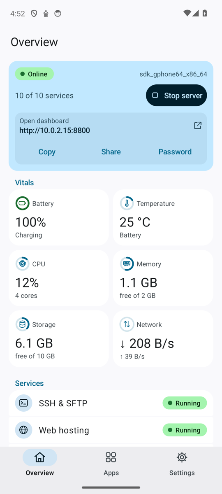
  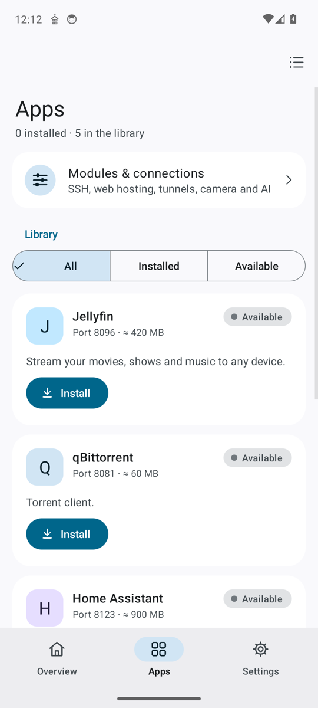
  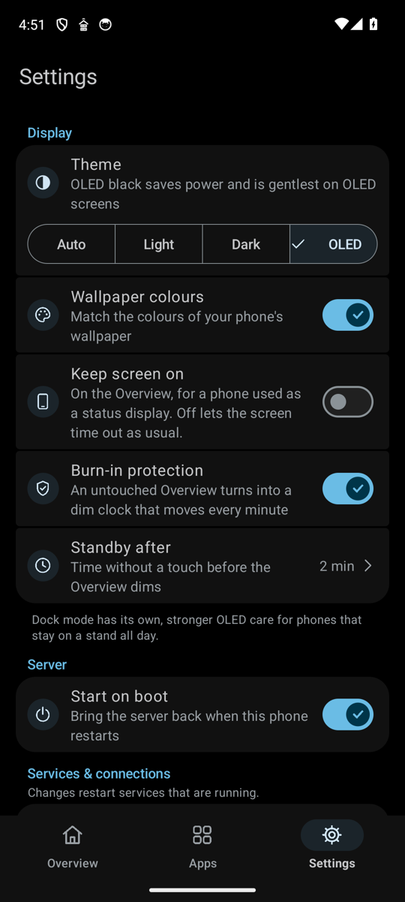
</p>

The phone app follows your wallpaper colours on Android 12+, or uses light, dark and OLED
black themes. An idle Overview can become a dim, drifting clock. App lock protects the phone
interface with a PIN or biometrics.

The dashboard ships inside the APK, so it works on your LAN without internet access. Pick
sidebar, rail, top bar, split, focus or kiosk mode; choose a theme and arrange overview widgets.
Use Ctrl/Cmd+K to jump between pages.

<p>
  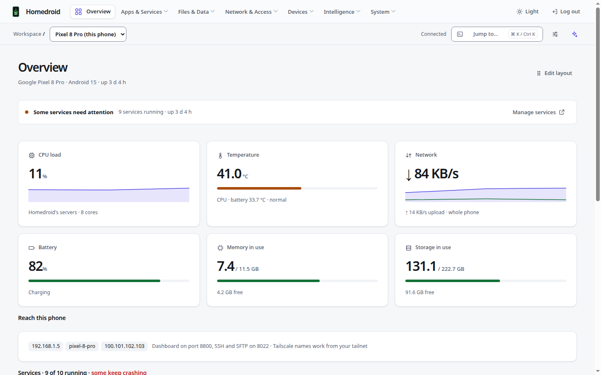
  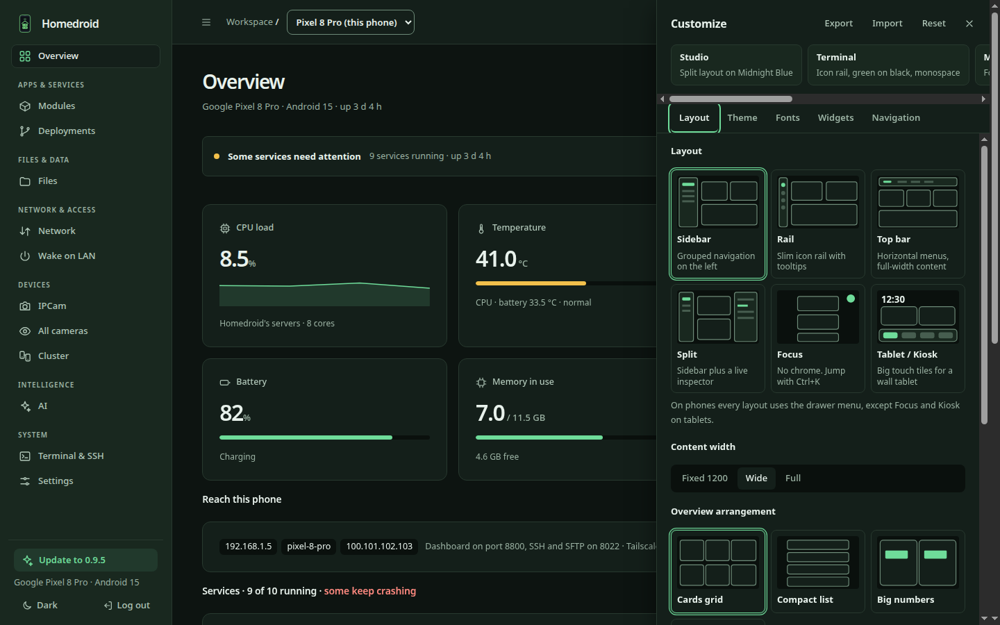
</p>

The dashboard has pages for Domains, Databases, MCP, Mail and Desktop & MacroPads:

<p>
  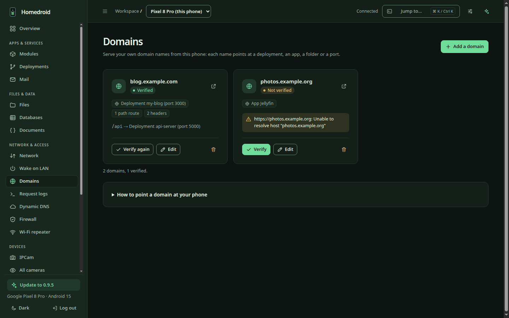
  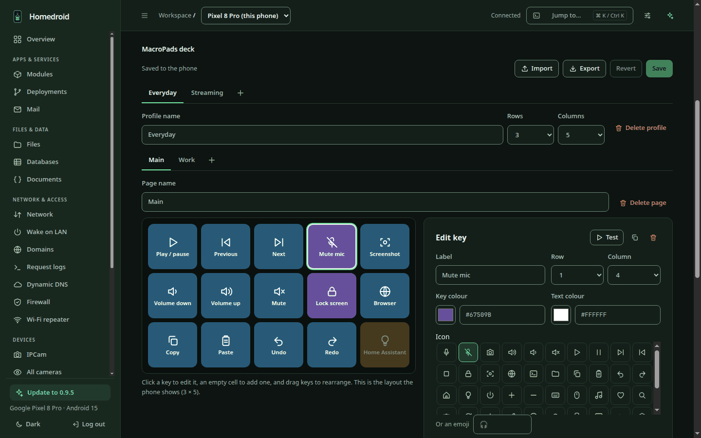
</p>

[Watch the current short phone and dashboard recordings](https://homedroid.seltiv.com/#tour).
The [older 0.9.4 walkthrough](https://github.com/sudiptacmd/homedroid/releases/download/v0.9.4-beta/homedroid-walkthrough.mp4)
still demonstrates media, storage, AI and clusters, but its interface predates this release.

## Dock mode

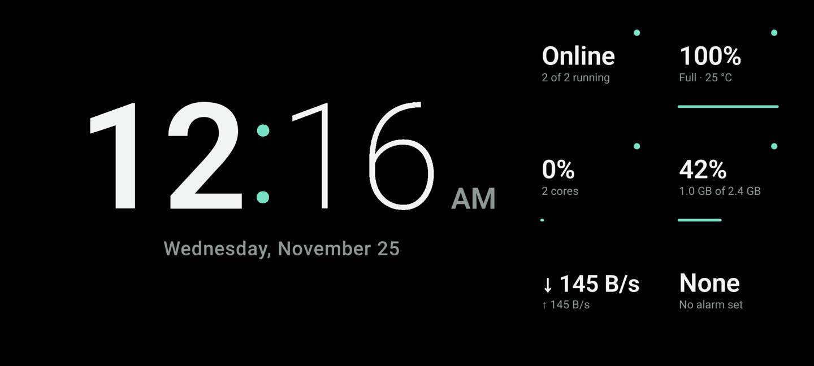

The server phone can be a clock while it charges. Pick one of five faces and add tiles for
server status, battery, CPU, memory, storage, network, uptime, Tailscale or the next alarm.
Use the red night mode at the bedside, open it when charging, or set it as Android’s screen saver.

OLED care includes pixel shifts, clock/tile swaps, dimming and screen-off hours. It reduces
static exposure; it is not a guarantee against burn-in. The redesigned status widget has four
sizes, and a separate clock widget opens Dock mode.
[Dock mode and battery care](https://homedroid.seltiv.com/dock/).

## MacroPads: custom buttons for your computer

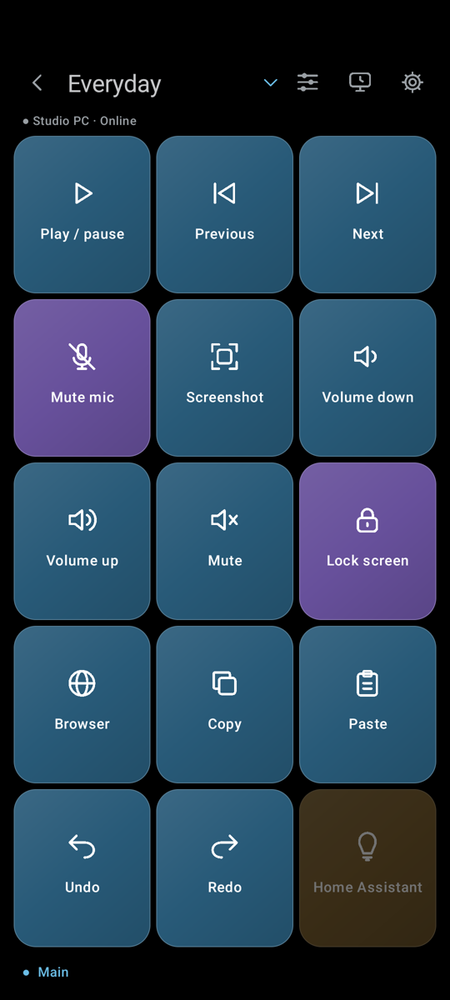

Open **Tools → MacroPads**. Long-press a button to set a hotkey, media key, text, app, URL,
mouse action or command. Make profiles and pages, change icons and colours, or chain desktop
actions into sequences. Grids range from 2×2 to 6×8. Import/export JSON backs up your deck. Restyle the deck with a
background colour, gradient or photo, your own font, key corners and glow, and 88 icons or your own images.

Tap the computer icon to pair Homedroid Desktop with a six-digit code. Codes last five minutes;
you can pair up to eight computers. The companion stays connected and acknowledges each action.
**Commands are refused until Allow commands is enabled on the computer.** Phone-side HTTP
buttons can call Home Assistant webhooks; the example is disabled until configured.

A toggle button’s colour is local feedback, not the computer’s measured mute/playback state.
The starter shortcuts may need changing for your OS and apps.
[MacroPads editing, pairing and action guide](docs/guides/macropads.md).

## Homedroid Desktop

Use the old Android phone as a wireless webcam and run MacroPads actions from the same companion.
The computer connects to the phone’s port 8800. Pair on a trusted LAN or use Tailscale; plain
HTTP does not encrypt tokens or video.

```sh
homedroid-desktop pair 192.168.1.20 123456
homedroid-desktop webcam --camera back --size 1280x720 --fps 30
homedroid-desktop run       # MacroPads without webcam
homedroid-desktop status
```

- **Linux:** v4l2loopback exposes the webcam to desktop apps. Without the module, preview and
  the network stream still work. MacroPads uses XTEST on X11 or uinput on Wayland; uinput needs
  device permissions.
- **Windows 11:** experimental virtual camera. Keep the DLL beside the executable and run
  `homedroid-desktop.exe install-camera` once as administrator. This has been compile-checked,
  not tested on real Windows hardware.
- **macOS and Windows 10:** add `http://127.0.0.1:8891/stream` to OBS and start OBS Virtual Camera.
  No signed macOS camera extension is shipped. macOS input needs Accessibility permission and
  remains experimental and untested on hardware.

Enable Desktop webcam access on the phone first. There is one stream per phone; stop IPCam
before starting the webcam because they reserve the camera exclusively. The camera picks a
nearby supported resolution and frame rate.
The Camera panel sets zoom, torch, focus (tap the preview to focus), exposure, white balance, rotation
and mirroring, shows only what your phone supports, and saves presets.
[Download table](#homedroid-desktop-downloads) · [Full Desktop instructions](desktop/README.md).

## USB drives and SD cards as a NAS

Connect a USB OTG drive or insert a microSD card. **Files** shows it beside the phone’s storage:
upload folders, stream media, preview pictures/PDFs and download folders as ZIP. SFTP exposes
accessible volumes under `/storage/<volume-id>` for sshfs, rclone, WinSCP or Cyberduck.

Choose a storage location per app. Media can go on removable storage; settings and databases
stay internal because removable drives are often FAT32 or exFAT. On Android 11+, granting
All files access allows a visible `Homedroid/<name>` folder. On Android 10, app-owned folders
on removable storage are deleted when Homedroid is uninstalled. The picker explains the limit.
FAT32 cannot hold files over 4 GB. If a drive disappears, apps wait for it instead of writing
somewhere unexpected.

## Jellyfin, Immich and home automation

Jellyfin and qBittorrent share the Media folder. Completed downloads appear in Jellyfin’s
Downloads library. **Hardware transcoding is encode-side:** H.264 and HEVC use the phone’s
MediaCodec encoder where supported. Decoding, scaling, subtitle burn-in and HDR tone mapping
still use software. Check your phone with your actual videos before promising it movie night.

Immich backs up photos and videos, with machine learning (faces and smart search) disabled.
Home Assistant supports network and cloud integrations; the Linux app cannot access USB
Zigbee/Z-Wave radios or Bluetooth. IPCam offers live view, captures and motion-triggered clips.
Camera/microphone access must be enabled from the phone, including again after a reboot.

## Hosting and deploying from GitHub

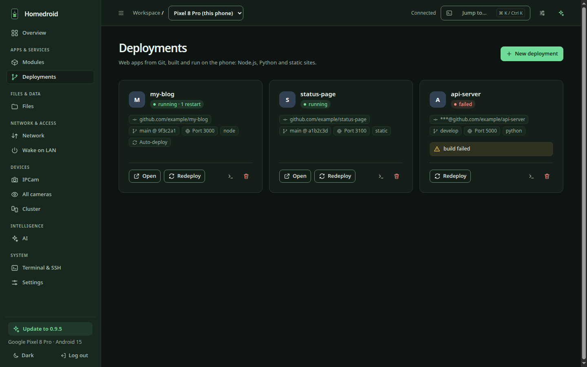

Give Homedroid a repository URL, branch and port. Set build/start commands and environment
variables as needed; apps receive `$PORT`. A failed build keeps the previous version running.
Auto-deploy checks the branch every five minutes. The runtime backend supports Node.js,
Python, Go, PHP, Bun, Deno and static sites.

The dashboard also has pages for verified domains and path routes, DuckDNS/Cloudflare dynamic
DNS, firewall rules and request logs. Deploy from ZIP/tar archives or CI with per-deployment tokens. Hooks
work with GitHub Actions, GitLab and CircleCI; GitHub push webhooks use signature verification.
A `.homedroid/pipeline.json` lists steps after the build and before startup. A failed step
stops the deploy. Rolling deployment and load balancing target paired cluster phones. Each
deployment has a Pipelines tab with run history and per-step timings.

[Deploy hooks, archive uploads and pipeline examples](docs/guides/deploy-hooks.md).
Load balancing has emulator verification, not verification across two physical phones.

## Local AI, MCP and databases

**Local AI:** install llama.cpp and a GGUF model on a 64-bit phone. Benchmark CPU and GPU to
pick the faster; GPU support depends on drivers. Chat locally or expose the keyed,
OpenAI-compatible API at `http://<phone-ip>:8090/v1`. Optional cloud providers and scheduled
routines can summarize feeds, email and server health. Local inference stays on the phone;
cloud requests go to the provider you choose.

**MCP:** assistants such as Claude, Cursor and VS Code can read status, logs, deployments and
files. A separate token protects `/mcp`; it is off by default. Write tools require Allow write.
The dashboard-agent backend uses the same tools and holds changes for approval.
The dashboard's **MCP** page has the switches, server addresses, token and an audit log. The
[MCP guide](docs/guides/mcp.md) includes client configurations.

**Databases:** the **Databases** page lists the SQLite files your apps keep, draws the schema
with its foreign keys, shows rows and has a SQL console. Reads are the default; writes need
explicit confirmation and are refused while the owning app is running. A JSON document store
sits next to it under **Documents**.

<p>
  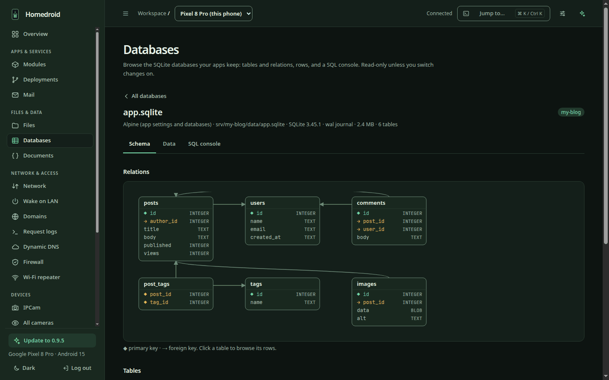
  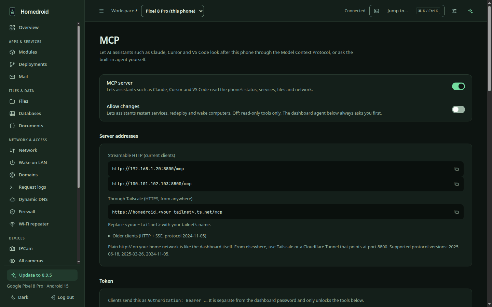
</p>

## Your own mail server

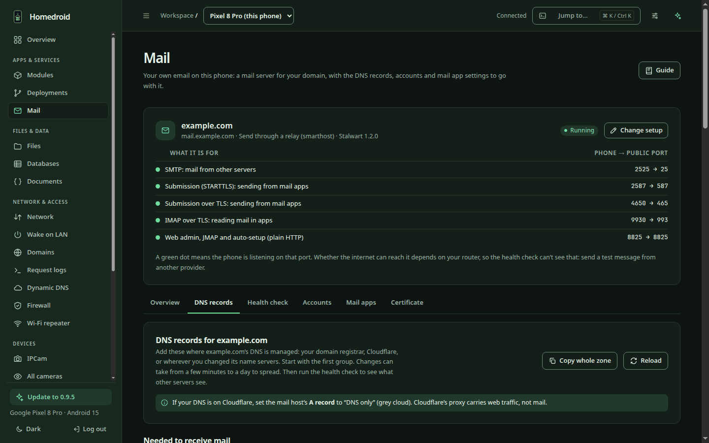

Install **Mail server (Stalwart)** from Modules, then open **Mail** in the dashboard. A wizard
asks for your domain, hostname and how mail reaches the phone. After that you get the DNS
records (MX, SPF, DKIM, DMARC) with copy buttons, health checks, mailboxes and the IMAP/SMTP
settings for your phone and computer mail apps. Phones with 2 GB of RAM or less may struggle; Stalwart wants
more memory than most apps here.

Running mail at home often does not work, and the phone cannot change why. Most home
providers block port 25. Many have no public address at all (CGNAT), and Gmail and Outlook
want reverse DNS that only your provider can set. The wizard offers three routes: direct,
send through a relay such as Mailgun or Amazon SES, or receive through a small VPS. A relay is
the dependable choice for sending. The checks run from the phone, so send a real message from
another provider to confirm.
[Mail server guide](docs/guides/mail.md).

## Wi-Fi repeater

The phone can share its connection through its own Wi-Fi network, without root. It creates a
Wi-Fi Direct group and runs an HTTP/HTTPS proxy on port 8282, a SOCKS5 proxy on 8284 and a PAC
file on 8283. Join the network by scanning the QR code, then point the device's proxy setting
at the phone, normally `192.168.49.1`.

This is a proxy, not a hotspot. Browsers and most apps built on the system networking work.
Games, calls, VPN clients and anything that ignores the proxy setting will not. Speed is a
fraction of your line speed because one radio serves both connections. Turn it on under
**Settings → Services & connections → Wi-Fi repeater** or from **Modules** in the dashboard.
[Wi-Fi repeater guide](docs/guides/wifi-repeater.md).

## Network services and phone clusters

**AdGuard Home** answers on **1053** because unrooted Android apps cannot bind port 53.
Homedroid’s Tailscale forwards tailnet DNS port 53 to it. Set the phone as a custom nameserver
and enable Override DNS servers in Tailscale, or use a router that supports an upstream DNS
port. AdGuard’s UI is on 3000.

**Wake on LAN** sends magic packets to saved computers from wherever you can reach the
dashboard. **Network tools** run on the phone: discovery, ping, traceroute, DNS, nmap, HTTP
checks, whois and iperf3/internet speed tests. Packet capture needs root and is not included.

**Cluster → Add a phone** pairs devices with a matching code. Switch phones in one dashboard,
move apps with their data, copy files directly between phones and view every camera together.
Cluster traffic uses mutual TLS on 8801. Paired phones can control one another, so protect
every dashboard. General app failover is not automatic.

<a id="known-limitations"></a>

## Requirements and limitations

- Android 10+; a 64-bit phone is recommended. Allow space for apps as well as media:
  Jellyfin roughly 420 MB (2 GB free recommended), Immich roughly 1.6 GB and Home Assistant
  roughly 900 MB. Sizes vary as upstream packages change.
- Linux apps use proot. System-call-heavy work, such as package installation and databases,
  has overhead. This is not a replacement for full Linux hardware access.
- Dashboard CPU is the load of Homedroid’s processes. Temperature is battery temperature and
  thermal status, plus CPU temperature where the phone exposes it.
- Battery savers can stop servers. Follow setup guidance, watch heat under load, and use a
  healthy battery. Homedroid cannot add charge limiting without root.
- Local HTTP is unencrypted. Use Tailscale or Cloudflare Tunnel for remote access.

A phone is useful for files, media and small services. A Raspberry Pi is a better fit for
GPIO, USB radios and an unrestricted Linux system.
[Old phone vs Raspberry Pi](https://homedroid.seltiv.com/compare/).

## How it works

Android will not run downloaded executables from app storage. Homedroid’s native servers are
packaged as `lib*.so` files so Android extracts them into the executable native-library path.
Linux apps run in Alpine under proot. Container images are unpacked and their processes run
under proot; there is no Docker daemon.

For Jellyfin, an FFmpeg shim redirects hardware encoding to an Android-built FFmpeg using
MediaCodec. The rest goes to Jellyfin’s own FFmpeg. Patches and build scripts live in
[`native/`](native/). The supervisor handles process groups so stopping proot does not leave
its child servers behind.

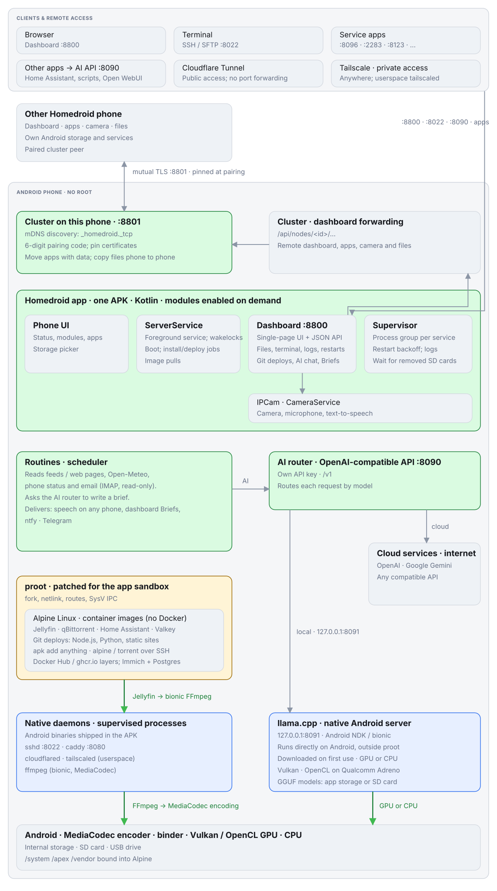

## Security

SSH accepts public keys only. The dashboard has a generated password and expiring
HttpOnly/SameSite sessions. That password also opens the web terminal, so treat it like an
SSH key. Authentication attempts are rate-limited; changing the password revokes sessions.

PIN/biometric app lock protects the phone UI, and Android Keystore encrypts stored secrets.
MCP has its own token and call audit log. Desktop command execution requires local opt-in.
Pair only computers and cluster phones you trust. Other Android apps can reach localhost;
qBittorrent’s localhost authentication exception exists for the `torrent` helper.

See the [0.8.5 security review](docs/SECURITY-REVIEW-0.8.5.md),
[0.9.0 security review](docs/SECURITY-REVIEW-0.9.0.md), and [Desktop security notes](desktop/README.md#security-notes).

## Building

Needs JDK 17+, Go 1.23+ and the Android SDK with NDK r27+. Linux/macOS setup helpers install
project-local tools (currently JDK 21, SDK 36 and NDK 30):

```sh
tools/setup-dev.sh --ndk --go
source tools/dev.sh
native/build-all.sh
./gradlew assembleRelease
adb install app/build/outputs/apk/release/app-arm64-v8a-release.apk
```

On Windows, `tools/dev.ps1` selects already-installed project-local tools. Native build scripts accept ABI
arguments, for example `native/build-ffmpeg.sh arm64-v8a`. To sign with your own key, copy
`keystore.properties.example` to `keystore.properties`; otherwise local builds use the debug
key and cannot update an official signed release. CI tags such as `v0.9.5-beta` publish signed
APKs and runtime archives; the Desktop workflow publishes the companion archives.

```sh
./gradlew testDebugUnitTest
node --test tests/*.test.cjs
cd desktop
cargo build --release
cargo test
```

The marketing site is static HTML/CSS/JS in [`site/`](site/), published by
[GitHub Pages](.github/workflows/pages.yml) at <https://homedroid.seltiv.com/>.
[Site validation and media capture](tools/marketing/README.md) needs no npm dependencies.

## Contributing and feedback

The most useful contribution is trying it on a phone and reporting what happened. Include the
model, Android version and service log. [`tools/bench.py`](tools/bench.py) measures your device;
emulator throughput is not evidence of real Wi-Fi performance.

- 🐛 [Report a bug](https://github.com/sudiptacmd/homedroid/issues/new?template=bug_report.yml).
- 📱 [Share your phone](https://github.com/sudiptacmd/homedroid/issues/new?template=phone_report.yml).
- 💡 [Suggest an app or feature](https://github.com/sudiptacmd/homedroid/issues/new?template=feature_request.yml).
- 🛠️ Add apps to [`apps.json`](app/src/main/assets/apps.json), fix a bug or improve the docs.
  Start with [CONTRIBUTING.md](CONTRIBUTING.md).

## Credits and license

Built by **Sudipta Goswami** and contributors. Homedroid and Homedroid Desktop are free software
under the [GNU General Public License v3.0](LICENSE). Bundled components keep their own
licenses; see [THIRD_PARTY.md](THIRD_PARTY.md). The earlier media walkthrough uses Blender
Foundation open movies (*Sintel*, *Big Buck Bunny*, *Elephants Dream*, *Tears of Steel*),
© Blender Foundation, [CC BY](https://creativecommons.org/licenses/by/3.0/).
